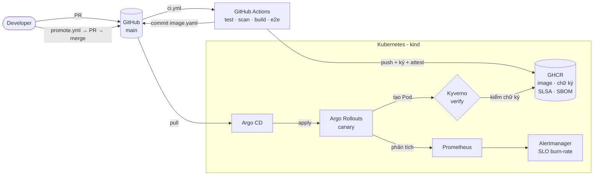

# CI/CD · Kubernetes · GitOps

[](https://github.com/taovietducofficial/CI-CD-Kubernetes-GitOps/actions/workflows/ci.yml)
[](https://scorecard.dev/viewer/?uri=github.com/taovietducofficial/CI-CD-Kubernetes-GitOps)

Một luồng phát hành phần mềm **theo chuẩn doanh nghiệp**, đầy đủ từ commit tới production, và **chạy được trên laptop của bạn**. Repo không phải slide: mọi thứ mô tả dưới đây đều chạy thật, có test, và mỗi quyết định đều có [ADR](docs/adr/) giải thích *vì sao* chọn như vậy.

```
commit ─► test · SAST · SCA · IaC scan ─► build một lần ─► e2e trên kind ─► ký + SLSA + SBOM
       ─► Git ghi digest ─► Argo CD kéo về ─► Kyverno kiểm chữ ký ─► canary + Prometheus ─► production qua PR
```

## Bạn sẽ học được gì

| Chủ đề | Trong repo này |
|---|---|
| **CI có cổng chất lượng** | Unit/web test, coverage ≥ 80%, CodeQL, Trivy (dependency, secret, Dockerfile, Helm), zizmor cho chính workflow |
| **Build once, deploy many** | Image build một lần thành `image.tar`. e2e chạy trên file đó, publish đẩy đúng file đó. Mọi môi trường trỏ tới **digest**, không dùng tag |
| **Supply-chain security** | Ký keyless bằng GitHub OIDC (Sigstore), SLSA provenance, SBOM CycloneDX, mọi action pin theo SHA |
| **GitOps** | Argo CD (pull model, app-of-apps, tự quản lý chính nó). CI không hề có quyền vào cluster |
| **Admission control** | Kyverno chặn image không do CI trên `main` ký. Cùng một policy chạy ở cả CI lẫn cluster, và có unit test |
| **Progressive delivery** | Argo Rollouts canary, Prometheus đo riêng pod canary, tự abort khi lỗi |
| **Vận hành (SRE)** | SLO 99.9%, alert multi-window burn-rate, runbook cho từng alert |
| **Secret trong Git** | Sealed Secrets, phạm vi strict theo namespace |
| **Kubernetes hardening** | distroless, non-root, read-only FS, PSA restricted, NetworkPolicy ingress + egress, PDB, HPA |

## Kiến trúc



Chi tiết hơn (pipeline, sequence diagram, chuỗi tin cậy, threat model) nằm trong [docs/architecture.md](docs/architecture.md).

## Bắt đầu nhanh

### Yêu cầu

- Docker cấp được **8 GB RAM** trở lên. Toàn bộ nền tảng (Argo CD, Kyverno, Prometheus/Grafana, Rollouts, hai môi trường JVM) đã được thử với Docker 4 GB và **không đủ**: control plane bị crash. Bản 1 node (`KIND_CONFIG=hack/kind-config-single.yaml`) chỉ bớt được phần overhead của hai node worker. Máy yếu hơn vẫn chạy được `make test`, `make lint` và `make e2e`.
- [kind](https://kind.sigs.k8s.io/), [kubectl](https://kubernetes.io/docs/tasks/tools/), [helm](https://helm.sh/) ≥ 3.14, `make`, `bash`.
- Tuỳ chọn: [kyverno CLI](https://kyverno.io/docs/kyverno-cli/) cho `make lint`, [kubeseal](https://github.com/bitnami-labs/sealed-secrets#kubeseal) cho `make seal`, plugin [kubectl argo rollouts](https://argo-rollouts.readthedocs.io/en/stable/installation/#kubectl-plugin-installation).
- Windows: dùng **Git Bash** hoặc **WSL2**.

### Dựng toàn bộ nền tảng

```sh
git clone https://github.com/taovietducofficial/CI-CD-Kubernetes-GitOps.git
cd CI-CD-Kubernetes-GitOps
make up        # tạo cluster kind, cài Argo CD, giao phần còn lại cho GitOps
make status    # theo dõi; lần đầu mất khoảng 5–10 phút
make ui        # Argo CD :8080 · Grafana :3000 · Prometheus :9090 · Rollouts :3100
make password  # mật khẩu admin của Argo CD
```

Sau `make up`, bạn **không cài thêm gì bằng tay**. Argo CD đọc [`deploy/argocd/apps/`](deploy/argocd/apps/) và lần lượt dựng mọi thứ theo sync wave:

1. Wave -1: Argo Rollouts, Kyverno, Sealed Secrets, metrics-server, kube-prometheus-stack, và chính Argo CD.
2. Wave 0: policy.
3. Wave 1: ứng dụng ở staging và production, mỗi môi trường xuất hiện khi đã có release cho nó.

> Muốn chạy với repo của riêng bạn (để CI, ký và promote hoạt động trên tài khoản của bạn)? Hãy fork rồi làm theo [docs/github-setup.md](docs/github-setup.md).

## Hành trình của một thay đổi

1. **Mở PR.** `ci.yml` chạy song song các job `app` (test + coverage), `codeql`, `security` (Trivy, zizmor, dependency-review), `deploy-lint` (chart, schema, kubeconform, policy) và `build`. Sau `build` là `e2e`: deploy image vừa build lên một cluster kind tạm, bật PSA restricted, rồi gọi API thật.
2. **Merge vào `main`.** Pipeline chạy lại từ đầu. Khi mọi job đã xanh, `publish` đẩy **đúng file `image.tar` đã qua e2e** lên GHCR, ký keyless, gắn SLSA provenance và SBOM, rồi tự kiểm chứng lại chữ ký.
3. **CI ghi vào Git, không đụng vào cluster.** Job `deploy-staging` commit `tag` và `digest` mới vào [`deploy/envs/staging/image.yaml`](deploy/envs/).
4. **Argo CD kéo về.** Trong vòng một phút, Argo CD thấy commit mới và cập nhật Rollout ở `app-staging`.
5. **Kyverno chặn ở cửa.** Pod chỉ được tạo khi image có chữ ký của `ci.yml@refs/heads/main` và provenance chứng minh nó được build từ repo này.
6. **Canary.** 50% số pod chạy bản mới. Prometheus đo tỉ lệ lỗi **của riêng các pod đó**. Dưới 99% thì Rollout tự abort và quay về bản cũ.
7. **Promote.** Chạy workflow *promote*. Một PR được mở, copy nguyên `image.yaml` từ staging sang production, kèm changelog và lệnh kiểm chứng. **Merge chính là phê duyệt.**
8. **Production.** Canary chạy chậm hơn (20% → 50% → 100%), có phân tích. Alert SLO canh chừng suốt phần còn lại của tháng.

## Thực hành

### 1. Đưa thay đổi đầu tiên lên staging

Sửa câu chào trong [`GreetingService.java`](app/src/main/java/io/github/taovietduc/demo/GreetingService.java), cập nhật test, mở PR rồi merge. Sau đó theo dõi:

```sh
git pull && git log -1 -- deploy/envs/staging/image.yaml   # commit deploy(staging) của bot
kubectl argo rollouts get rollout demo-service -n app-staging --watch
```

### 2. Canary hỏng thì tự rollback

```sh
make load ENV=staging            # tạo traffic, để analysis có dữ liệu mà đo
```

Bật lỗi giả lập trong [`deploy/envs/staging/values.yaml`](deploy/envs/staging/values.yaml), rồi commit và push:

```yaml
env:
  APP_CHAOS_ERROR_RATE: "0.5"    # 50% request trả 500
```

Khoảng một phút sau, `AnalysisRun` fail, Rollout chuyển sang `Degraded`, và **bản cũ vẫn phục vụ 100% traffic**. Đọc [runbook](docs/runbooks.md#canary-bi-abort), rồi revert commit vừa tạo và chạy `make load-stop`.

### 3. Promote lên production

**Actions → promote → Run workflow**, hoặc:

```sh
gh workflow run promote.yml
gh pr list --head promote/   # review PR: digest, changelog, checklist
```

Merge PR, rồi xem production chạy canary 20% → 50% → 100%.

### 4. Rollback bằng Git

```sh
git revert <merge-commit-của-PR-promote> && git push   # hoặc qua PR khi đã bật ruleset
```

Image cũ vẫn còn trên GHCR và vẫn có chữ ký hợp lệ, nên production quay về bản trước trong vài phút. Xem [runbook](docs/runbooks.md#rollback-thu-cong) để hiểu vì sao không dùng `kubectl` cho việc này.

### 5. Image không ký thì không chạy được

```sh
# Image chỉ có tag, không có digest: workload-baseline từ chối
kubectl -n app-staging apply --dry-run=server -f - <<'EOF'
apiVersion: v1
kind: Pod
metadata: { name: unsigned }
spec:
  securityContext: { runAsNonRoot: true, runAsUser: 65532, seccompProfile: { type: RuntimeDefault } }
  containers:
    - name: app
      image: ghcr.io/taovietducofficial/ci-cd-kubernetes-gitops:latest
      resources: { requests: { cpu: 10m, memory: 64Mi }, limits: { memory: 64Mi } }
      readinessProbe: { httpGet: { path: /readyz, port: 8080 } }
      livenessProbe: { httpGet: { path: /livez, port: 8080 } }
      securityContext: { allowPrivilegeEscalation: false, capabilities: { drop: [ALL] } }
EOF
```

Để thấy kiểm tra chữ ký hoạt động: build image ở máy bạn, `docker push` lên GHCR với một tag riêng, lấy digest, rồi thay vào `image:` ở trên (dạng `…:tag@sha256:…`). Kyverno sẽ trả về `image is not signed by this repository's CI on main`. Đó chính là điều repo này bảo vệ: **có quyền push registry vẫn không đủ để chạy code**.

### 6. Thêm một secret

```sh
printf 's3cr3t' | make seal ENV=staging   # in ra chuỗi đã mã hoá
```

```yaml
# deploy/envs/staging/values.yaml
sealedSecrets:
  GREETING_API_TOKEN: AgB...   # dán chuỗi vừa nhận được
```

Commit và push. Pod nhận biến môi trường `GREETING_API_TOKEN`, và đổi secret sẽ tự kích hoạt một rollout mới. Chuỗi này **chỉ** giải mã được trong `app-staging` của đúng cluster của bạn ([ADR-0006](docs/adr/0006-sealed-secrets.md)).

## Cấu trúc repo

```
app/                        Spring Boot service + Dockerfile (distroless, layered)
deploy/
  chart/                    Helm chart + values.schema.json + ci/test-values.yaml
  envs/<env>/values.yaml    cấu hình môi trường (người sửa)
  envs/<env>/image.yaml     build đang chạy (CI / PR promote ghi)
  argocd/bootstrap/         thứ duy nhất cài bằng tay: values Argo CD + root Application
  argocd/apps/              AppProjects, platform add-ons, ApplicationSet của app
  platform/                 values cho chart platform lớn
  policies/                 Kyverno policies + tests/ (kyverno test)
hack/                       kind config, e2e.sh (dùng chung cho CI và local)
docs/                       kiến trúc, ADR, runbooks, thiết lập GitHub
.github/workflows/          ci.yml · promote.yml · scorecard.yml
Makefile                    điểm vào duy nhất cho mọi thao tác
```

## Lệnh thường dùng

```
make test       unit + web test, coverage gate
make lint       chart, schema, kubeconform, kyverno test, policy vs manifest
make e2e        build image, deploy lên kind tạm, smoke test
make up/down    dựng / xoá cluster local
make status     Applications và Rollouts
make ui         port-forward các dashboard
make seal       mã hoá secret cho một môi trường
make load       tạo traffic cho canary analysis
```

## Tài liệu

- [Kiến trúc, chuỗi tin cậy, threat model, SLO](docs/architecture.md)
- Quyết định kiến trúc (ADR):
  [0001 monorepo và con trỏ release](docs/adr/0001-monorepo-va-con-tro-release.md) ·
  [0002 build một lần, promote theo digest](docs/adr/0002-build-mot-lan-promote-theo-digest.md) ·
  [0003 ký keyless và SLSA](docs/adr/0003-ky-keyless-va-slsa-provenance.md) ·
  [0004 Kyverno](docs/adr/0004-kyverno-admission-control.md) ·
  [0005 canary](docs/adr/0005-canary-voi-argo-rollouts.md) ·
  [0006 Sealed Secrets](docs/adr/0006-sealed-secrets.md) ·
  [0007 Renovate](docs/adr/0007-renovate.md) ·
  [0008 những gì cố ý không làm](docs/adr/0008-nhung-gi-co-y-khong-lam.md)
- [Runbooks](docs/runbooks.md)
- [Thiết lập GitHub](docs/github-setup.md)
- [Bảo mật](SECURITY.md)
