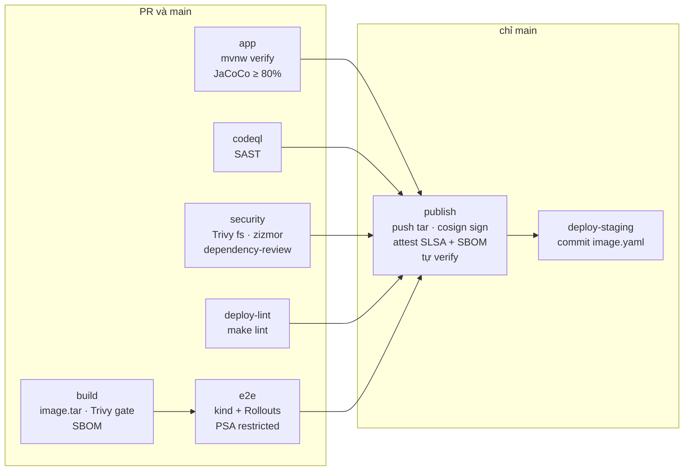
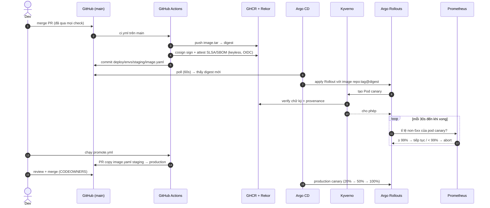

# Kiến trúc

Tài liệu này mô tả hệ thống **chạy như thế nào** và **vì sao lại an toàn**. Lý do cho từng lựa chọn nằm trong các [ADR](adr/).

## 1. Thành phần

| Thành phần | Ở đâu | Vai trò |
|---|---|---|
| `demo-service` | `app/` | Spring Boot 4, Java 21. Một endpoint `GET /api/v1/greetings`, metrics Prometheus ở port 8081 |
| Helm chart | `deploy/chart/` | Rollout, Service, HPA, PDB, NetworkPolicy, PodMonitor, PrometheusRule, AnalysisTemplate, SealedSecret |
| GitHub Actions | `.github/workflows/` | `ci.yml` build, kiểm tra, ký, ghi release vào Git. `promote.yml` mở PR promote |
| GHCR | `ghcr.io/taovietducofficial/ci-cd-kubernetes-gitops` | Image, chữ ký, SLSA provenance, SBOM (OCI referrers) |
| Argo CD | namespace `argocd` | Kéo trạng thái mong muốn từ Git và áp vào cluster. Tự quản lý chính nó |
| Argo Rollouts | namespace `argo-rollouts` | Canary + phân tích tự động + abort |
| Kyverno | namespace `kyverno` | Admission: baseline workload, verify chữ ký và provenance |
| kube-prometheus-stack | namespace `monitoring` | Prometheus, Alertmanager, Grafana. SLO recording rules và alerts |
| Sealed Secrets | namespace `kube-system` | Giải mã secret đã seal trong Git |
| metrics-server | namespace `kube-system` | Resource metrics cho HPA |

## 2. Pipeline CI

- Các job kiểm tra chạy **song song**. Chỉ `publish` chờ tất cả.
- `publish` không build lại. Nó đẩy đúng `image.tar` mà `e2e` đã chạy ([ADR-0002](adr/0002-build-mot-lan-promote-theo-digest.md)).
- **CI không có credential của cluster.** Bước cuối của CI là một commit vào Git.

## 3. Từ commit tới production

## 4. Chuỗi tin cậy

Mỗi mắt xích chỉ tin mắt xích ngay trước nó, và mỗi bước đều kiểm chứng được:

| Bước | Bảo đảm | Ai kiểm tra |
|---|---|---|
| Commit vào `main` | Đã qua review và tất cả check (khi bật ruleset) | GitHub ruleset |
| Image trên GHCR | Đúng là artifact đã qua e2e và Trivy | Cùng một file tar, digest trong log |
| Chữ ký | Do `ci.yml@refs/heads/main` của repo này tạo. Ghi vết công khai trên Rekor | Kyverno, `cosign verify` |
| SLSA provenance | Build từ repo này, ref `main`, commit cụ thể | Kyverno (CEL kiểm tra nội dung), `gh attestation verify` |
| `image.yaml` | Thay đổi của production phải qua PR được duyệt | CODEOWNERS + ruleset |
| Pod chạy | Đúng digest, đáp ứng baseline và PSA restricted | Kyverno + Pod Security Admission |

Hệ quả: dù kẻ tấn công có quyền push vào GHCR, **hoặc** sửa được `image.yaml`, họ vẫn không chạy được image tự build. Image đó không có chữ ký từ workflow trên `main`.

## 5. Ranh giới quyền hạn

- **GitHub Actions**: mặc định `permissions: {}`, mỗi job chỉ xin đúng quyền cần dùng. `id-token: write` chỉ có ở `publish`. Không có kubeconfig ở đâu cả.
- **Argo CD**: chạy trong cluster và kéo từ Git (pull model). AppProject `apps` chỉ được tạo một danh sách kind cố định trong namespace `app-*`. Nó không tạo được ClusterRole và không động được tới `kyverno` hay `kube-system` ([projects.yaml](../deploy/argocd/apps/projects.yaml)).
- **Pod ứng dụng**: không mount service account token, chạy non-root với root filesystem read-only. NetworkPolicy chỉ cho phép vào port 8080, port 8081 chỉ mở cho namespace `monitoring`, và chiều ra chỉ được gọi DNS.

## 6. Mô hình mối đe doạ (rút gọn)

| Mối đe doạ | Biện pháp | Rủi ro còn lại |
|---|---|---|
| Dependency có CVE | Trivy fs + image (gate HIGH/CRITICAL đã có bản vá), dependency-review trên PR, Renovate | CVE chưa có bản vá: theo dõi qua tab Security |
| Action bên thứ ba bị chiếm quyền rồi đẩy đè tag | Pin theo commit SHA, zizmor, Renovate cập nhật có review | Commit độc hại được Renovate đề xuất mà reviewer không phát hiện |
| Secret bị commit | Trivy secret scan, Sealed Secrets | Secret đã lộ trong lịch sử: phải đổi giá trị gốc |
| Image giả trên registry | Keyless signature + provenance, Kyverno fail-closed | Workflow `ci.yml` trên `main` bị sửa độc hại (giảm thiểu bằng CODEOWNERS cho `.github/`) |
| Sửa cấu hình production không qua review | CODEOWNERS + ruleset | Admin bypass ruleset |
| Release lỗi lan ra toàn bộ người dùng | Canary + analysis tự abort, SLO burn-rate alerts | Lỗi không biểu hiện bằng 5xx (sai dữ liệu): cần test nghiệp vụ |
| Container bị chiếm quyền | distroless, non-root, read-only FS, drop ALL, seccomp, không SA token, egress chỉ DNS | Lỗ hổng kernel hoặc container runtime |

## 7. Quan sát và SLO

- **SLI**: tỉ lệ request `/api/**` trả 5xx. Probe và actuator không tính, vì chúng không phản ánh trải nghiệm người dùng.
- **SLO**: 99.9% trong 30 ngày, tức error budget khoảng 43 phút lỗi toàn phần mỗi tháng.
- **Alert theo burn rate** (multi-window, multi-burn-rate, SRE Workbook chương 5):

  | Alert | Ngưỡng | Cửa sổ | Hết budget sau | Mức độ |
  |---|---|---|---|---|
  | BurnFast | 14.4× (1.44% lỗi) | 1h và 5m | khoảng 2 ngày | page |
  | BurnSlow | 6× (0.6% lỗi) | 6h và 30m | khoảng 5 ngày | ticket |

  Cửa sổ dài chứng minh mức tiêu hao là đáng kể. Cửa sổ ngắn chứng minh lỗi vẫn đang diễn ra, nên alert tự tắt nhanh khi đã khắc phục. So với alert kiểu "5xx > 1% trong 5 phút", cách này ít báo động giả hơn và không bỏ sót lỗi âm ỉ kéo dài.
- **Log**: JSON theo chuẩn ECS (`logging.structured.format.console: ecs`), sẵn sàng đưa vào Loki hoặc Elasticsearch mà không cần parser.
- **Dashboard**: JVM (Micrometer) và Spring Boot Statistics, được Grafana tải theo `gnetId`.
